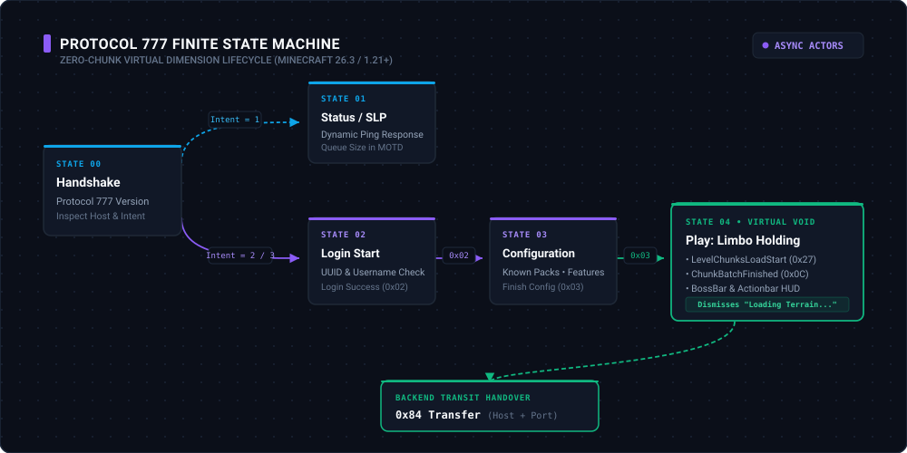

# Zenith Protocol 777 Specification

This document details the network protocol implementation used by Zenith for Minecraft: Java Edition 26.3 (`Protocol 777`), compatible with [Horizon](https://github.com/horizon-rust/horizon) and proxies like [Meridian](https://github.com/Akirabane/Meridian).

---

## 1. Protocol Architecture & Invariants

Zenith implements a **zero-chunk virtual dimension**. Unlike standard Minecraft servers, Zenith does not generate, light, or send chunk data. Players are held in a virtual void state with negligible CPU and memory footprint (< 1 KiB per session actor).

### Wire Constants & Limits
- **Protocol Version:** `777`
- **VarInt Max Size:** 5 bytes (values between `i32::MIN` and `i32::MAX`).
- **Pre-Play Frame Limit:** `32,768` bytes (32 KiB). Any frame exceeding this during Handshake, Status, Login, or Configuration causes immediate socket termination.
- **Play State Frame Limit:** `2,097,152` bytes (2 MiB).
- **Pre-Play Read Timeout:** 15 seconds (Anti-Slowloris protection).
- **Play Idle Heartbeat Timeout:** 30 seconds.

---

## 2. State Machine & Packet Mapping



### State 0: Handshake

| ID | Bound | Packet | Payload Structure |
|---|---|---|---|
| `0x00` | Serverbound | `Handshake` | `[ProtocolVersion: VarInt] [ServerAddress: String(255)] [ServerPort: u16] [Intent: VarInt]` |

*Intent values:* `1 = Status`, `2 = Login`, `3 = Transfer`.

---

### State 1: Status

| ID | Bound | Packet | Description |
|---|---|---|---|
| `0x00` | Serverbound | `StatusRequest` | Empty payload. |
| `0x00` | Clientbound | `StatusResponse` | Length-prefixed JSON string with server description, version, and max players. |
| `0x01` | Serverbound | `PingRequest` | `[Payload: i64]` timestamp. |
| `0x01` | Clientbound | `PongResponse` | `[Payload: i64]` identical timestamp echoed back. |

---

### State 2: Login

| ID | Bound | Packet | Description |
|---|---|---|---|
| `0x00` | Serverbound | `LoginStart` | `[Name: String(16)] [UUID: u128]` |
| `0x02` | Clientbound | `LoginSuccess` | `[UUID: u128] [Username: String] [PropertiesCount: VarInt (0)]` |
| `0x03` | Serverbound | `LoginAcknowledged` | Transitions connection to Configuration state. |

---

### State 3: Configuration

| ID | Bound | Packet | Description |
|---|---|---|---|
| `0x03` | Clientbound | `FinishConfiguration` | Empty payload, notifies client configuration phase is done. |
| `0x03` | Serverbound | `FinishConfiguration` | Client confirms configuration; transitions connection to Play state. |

---

### State 4: Play (Virtual Limbo Holding)

In this state, the player is maintained in virtual limbo without terrain.

| ID | Hex | Bound | Packet | Purpose in Zenith |
|---|---|---|---|---|
| `50` | `0x32` | Clientbound | `LoginPlay` | Sets dimension to `minecraft:overworld`, gamemode to Creative/Fly, view distance to 2, flat void environment. |
| `73` | `0x49` | Clientbound | `SynchronizePlayerPosition` | Positions player at `(X: 0.0, Y: 64.0, Z: 0.0)`, Yaw `0.0`, Pitch `0.0`. |
| `45` | `0x2D` | Clientbound | `ClientboundKeepAlive` | `[Id: i64]` periodic heartbeat sent every 10 seconds. |
| `28` | `0x1C` | Serverbound | `ServerboundKeepAlive` | `[Id: i64]` client heartbeat echo. Used for RTT calculation. |
| `132` | `0x84` | Clientbound | `Transfer` | `[Host: String] [Port: VarInt]` dispatches client to destination server without disconnect. |
| `10` | `0x0A` | Clientbound | `BossBar` | Displays real-time queue position and progress percentage. |
| `72` | `0x48` | Clientbound | `SetActionbarText` | Displays countdown ETA and queue status in the Actionbar. |

---

## 3. Cryptographic Token Forwarding (HMAC-SHA256)

For proxy integration (Meridian, Velocity), Zenith supports cryptographic player identity verification via signed tokens:

```
[UUID: 16 bytes] [Timestamp: 8 bytes big-endian] [Signature: 32 bytes HMAC-SHA256]
```

- **Replay Protection:** Verified against a sliding window (default $\pm 30\text{ seconds}$).
- **Integrity:** Tampered UUIDs or altered timestamps invalidate the SHA-256 signature immediately.

---

## 4. Horizon Native Turbo IPC Protocol (`#7484`)

When connecting to Horizon dedicated servers, Zenith communicates over local Unix domain socket (`ctl.sock`) or local TCP socket:

1. **Status Query (`status`)**:
   Returns microsecond MSPT (`mspt_us`), active player count, and ticks per second without network RTT.
2. **Player Pre-Warm Hand-Over (`player-expect`)**:
   Notifies Horizon of an incoming transfer:
   ```
   player-expect <UUID> <Username> <Dimension> <Timestamp>
   ```
   Horizon allocates player memory buffers in advance.
3. **Arrival Confirmation (`player-confirm`)**:
   Acknowledges completion of client transfer.
