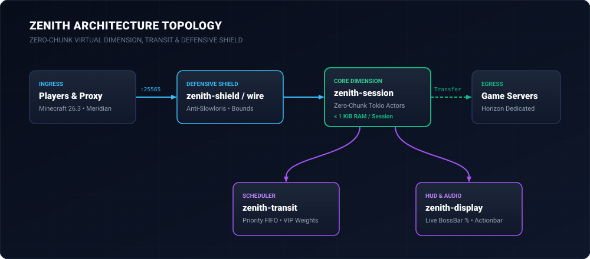

# Zenith Architecture Specification

Zenith is a high-throughput, zero-chunk virtual holding and transit gatekeeper designed for the Minecraft / Horizon server ecosystem.

---

## 1. System Topology & Data Flow



Zenith separates protocol parsing, actor lifecycle, queue scheduling, and security hardening across 7 production crates (`unsafe_code = "forbid"`), backed by isolated testing and benchmarking harnesses:

| Crate | Responsibility |
|---|---|
| `zenith-wire` | Low-level binary protocol codec (VarInts, framing, Protocol 777 typed packets). |
| `zenith-session` | Zero-chunk virtual dimension holding, Tokio actor task per connection. |
| `zenith-transit` | Priority FIFO queue scheduler and transfer trigger. |
| `zenith-display` | HUD interface builder (animated BossBar, Actionbar, audio cues). |
| `zenith-shield` | Defensive cybersecurity layer (anti-Slowloris, frame bounds, rate-limits). |
| `zenith-totem` | Crash recovery and backend evacuation lifeline. |
| `zenith-app` | Production server daemon binary (`src/main.rs`). |
| `zenith-testkit` | Scripted bot clients and backend fixtures for headless integration testing (`[dev-dependencies]`). |
| `zenith-bench` | Standalone multi-scenario load testing harness and memory profiler (`publish = false`). |

---

## 2. Protocol 777 Wire & Virtual Holding Architecture

### 2.1 Wire Framing (`zenith-wire`)
Frames follow the vanilla Protocol 777 wire format:
```
[TotalLength: VarInt] [PacketID: VarInt] [Payload: Bytes]
```
- Handshake negotiation identifies connection intention (`Status = 1`, `Login = 2`, `Transfer = 3`).
- Login phase completes offline/online profiles and acknowledges transition to Configuration.
- Configuration phase completes registry handshakes and transitions directly to Play.

### 2.2 Defensive Shield (`zenith-shield`)
- **Anti-Slowloris Deadlines**: Read timeouts are strictly bounded (15s for handshake/login, 30s for play idle).
- **Hard Payload Bounds**: Pre-play payloads are capped at 32 KiB; play payloads at 2 MiB.
- Attempts to exhaust memory or stall sockets result in immediate, clean connection termination without panic.

### 2.3 Zero-Chunk Virtual Session (`zenith-session`)
- Each player connection runs in an isolated, lightweight Tokio actor task (< 1 KiB idle memory RSS).
- The player is placed in a minimalist virtual skybox/void dimension.
- No terrain chunks, block entities, or physics ticks are allocated.
- A periodic heartbeat ping/pong (`KeepAlive`) monitors connection health and measures player round-trip latency.

---

## 3. Invariants & Guarantees

1. **Zero Physics Overhead**: No chunk meshes, block entities, or pathfinding ticks are allocated.
2. **Deterministic Memory**: Sessions are bounded lightweight actors (< 1 KiB per idle session).
3. **Rust Strictness**: `unsafe_code = "forbid"` is enforced across all crates. No undocumented panics or unwrap in runtime paths.
4. **Proxy Interoperability**: Seamless integration with modern Minecraft proxies (Meridian, Velocity) via modern forwarding and client transfer primitives.
