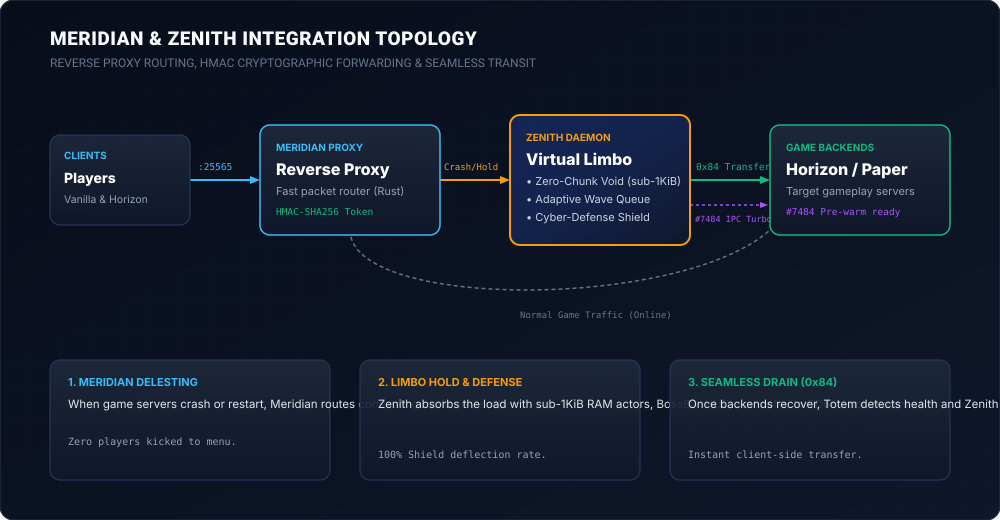

# Meridian & Zenith Integration Guide

This guide details the integration architecture, packet flows, and configuration patterns between **[Meridian](https://github.com/Akirabane/Meridian)** (high-throughput Rust Minecraft reverse proxy) and **Zenith** (virtual limbo holding, priority queue scheduler, and cyber-defense daemon).

---

## 1. Architectural Topology & Roles



In a high-density network deployment:
- **Meridian** acts as the public-facing gateway and connection router (port `:25577` or `:25565`).
- **Zenith** operates as the **zero-chunk crash recovery fallback & priority transit gatekeeper**:
  - When backend game servers (Horizon, Paper, Folia, Fabric) are restarting, updating, crashing, or under high load, Meridian automatically delegates incoming player connections to Zenith instead of disconnecting them.
  - Zenith absorbs connections into an ultra-low-memory virtual void (< 1 KiB RAM per session), renders dynamic HUD displays (BossBar, Actionbar ETA), defends against cyber attacks (Slowloris, bot floods), and organizes players into a priority-sorted wave queue.
  - When the destination backend recovers, Zenith seamlessly transfers players via the native Minecraft `0x84 Transfer` packet.

---

## 2. Cryptographic Player Forwarding (HMAC-SHA256)

To maintain end-to-end player identity authenticity across Meridian, Zenith, and downstream backends without relying on unauthenticated IP spoofing, Zenith supports **HMAC-SHA256 cryptographic token forwarding** (`zenith-wire::hmac`).

### Token Payload Specification
```
[UUID: 16 bytes] [Timestamp: 8 bytes big-endian] [Signature: 32 bytes HMAC-SHA256]
```

1. **Generation (Meridian or Zenith)**:
   - Payload is formed by concatenating the player's 128-bit UUID and current UNIX epoch timestamp in seconds.
   - HMAC-SHA256 is calculated over `UUID || Timestamp` using a shared cluster secret (`hmac_secret`).
2. **Verification & Drift Window**:
   - The recipient verifies the HMAC signature using the shared secret.
   - A configurable drift window (default: $\pm 30\text{ seconds}$) prevents replay attacks while tolerating clock jitter across nodes.
3. **Rust Implementation**:
   ```rust
   use zenith_wire::HmacForwarding;

   let hmac = HmacForwarding::new("shared_cluster_secret_key");
   let token = hmac.sign_token(player_uuid);
   assert!(hmac.verify_token(player_uuid, &token, 30));
   ```

---

## 3. Operational Flows

### Flow A: Backend Maintenance / Crash Evacuation
1. Backend server `:25566` becomes unresponsive or enters scheduled maintenance.
2. Meridian detects the offline status and routes newly connecting players to Zenith on `:25565`.
3. Zenith accepts connections, applies `zenith-shield` verification, and spawns a lightweight virtual actor in `zenith:limbo`.
4. Players receive real-time queue position in their BossBar, and estimated time remaining in their Actionbar.

### Flow B: Health Recovery & Adaptive Wave Evacuation
1. `zenith-totem` continuously polls backend `:25566` via Server List Ping (SLP) or Horizon Turbo IPC (`ctl.sock`).
2. Once the backend achieves 2 consecutive successful health checks, `zenith-transit` initiates queue evacuation.
3. Players are partitioned into waves according to their priority tier (Staff $\to$ VIP $\to$ Standard) and sorted by ping latency.
4. Zenith issues `ClientboundTransferPacket` (`0x84 / 132`):
   - Host: Target backend IP or Meridian routing port.
   - Port: Target backend port.
5. The Minecraft client transitions to the destination server client-side without returning to the main menu or experiencing a loading screen freeze.

---

## 4. Configuration Examples

### Zenith Configuration (`zenith.toml`)
```toml
[server]
bind = "0.0.0.0:25565"
target = "127.0.0.1:25566"
mode = "queue"

[queue]
wave_size = 15
wave_interval_ms = 1000
sorting = "ping"
groups_file = "groups.toml"

[totem]
enabled = true
probe_interval_ms = 1000
consecutive_successes = 2

[forwarding]
hmac_secret = "your_production_secret_key_here"

[shield]
enabled = true
max_connections_per_ip = 5
ip_rate_limit = 5.0
jail_duration_secs = 900
```

### Meridian Fallback Route Example
```toml
# In Meridian proxy configuration (meridian.toml)
accept-transfers = true # Enable to accept incoming 0x84 client transfers from Zenith

[[servers]]
name = "lobby"
address = "127.0.0.1:25566"
fallback = "zenith-limbo"

[[servers]]
name = "zenith-limbo"
address = "127.0.0.1:25565"
forwarding_mode = "zenith-hmac"
forwarding_secret = "your_production_secret_key_here"
```
